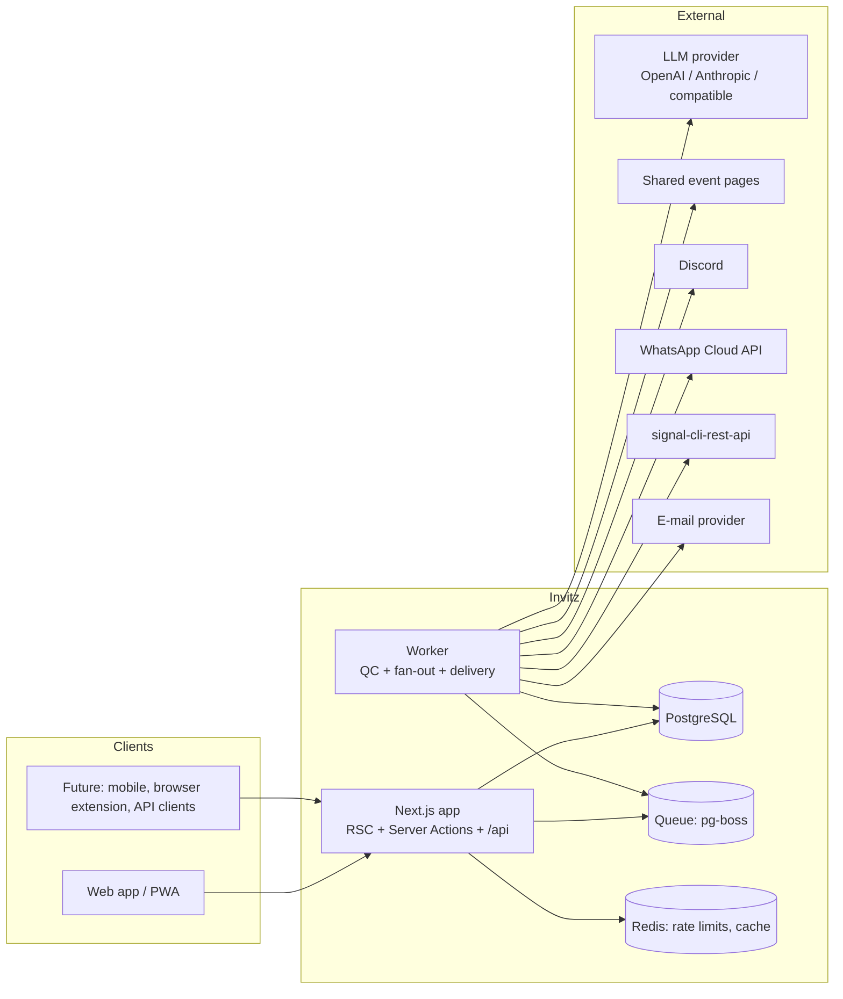
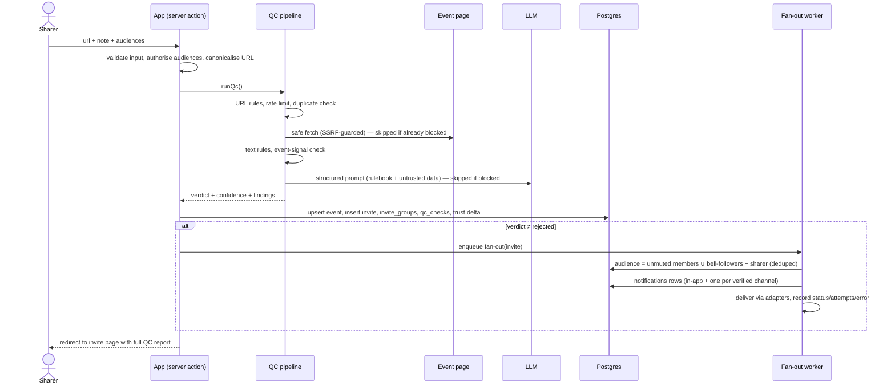

# 01 — Architecture

## 1. Guiding principles

1. **Modular monolith first.** One Next.js codebase + one worker process. Clear module boundaries (`qc`, `notify`, `groups`, `social`) so any module can be extracted later. Microservices on day one would be pure cost.
2. **Everything volatile sits behind an interface.** AI provider, notification channels, auth, queue, storage. Swapping is a one-file change.
3. **Policy is data.** QC rules and AI guidelines live in the DB (`qc_guidelines`), editable without a deploy.
4. **Never trust external content.** Links, page text, notes and model output are untrusted at every step.
5. **Fail safe, not open.** If the AI is down, invites are labelled *Caution* — never silently *Verified*.
6. **Everything auditable.** Every verdict stores its findings, model, confidence and timing in an immutable `qc_checks` row.
7. **Async by default for anything slow** (QC, fan-out, external delivery) — the prototype runs them inline/`after()`, production runs them on a queue.

## 2. System context



## 3. Module map (matches the prototype's folders)

```
src/
  app/                    # routes (UI) + server actions
    actions/              # auth, invites, groups, social, settings  (thin: validate → call lib → revalidate)
    invites/[id]  groups/  people/  settings/  notifications/  guidelines/  share/  login/
  components/             # presentational UI only
  db/                     # schema.ts (single source of truth), index.ts (pool)
  lib/
    auth.ts               # session interface (swap implementation in P1)
    queries.ts            # read models (feed, visibility rules)
    bootstrap.ts          # idempotent seed → becomes migrations/seed script
    url.ts format.ts      # pure helpers
    qc/
      rules.ts            # deterministic rules (no I/O)
      fetch-page.ts       # SSRF-safe fetch + metadata extraction
      ai.ts               # provider adapters + prompt + output validation
      pipeline.ts         # orchestration + decide() (pure)
    notify/
      adapters.ts         # one adapter per channel
      dispatch.ts         # audience resolution, dedupe, delivery bookkeeping
```

**Dependency rule:** `app → lib → db`. `lib/qc` and `lib/notify` never import from `app` or each other. `decide()`, `inspectUrl()`, `inspectText()` are pure functions (unit-test heavily).

## 4. Key flows

### 4.1 Share an invite



### 4.2 QC decision table (implemented in `decide()`)

| Condition | Verdict | Label shown |
|---|---|---|
| Any enabled **block**-severity finding (HTTPS-only, raw IP, blocklist, scam language, rate limit, duplicate) | **Rejected** (conf 0.95) | "Blocked", nobody notified, reasons shown to sharer |
| AI unavailable / errored / not configured | **Caution** (conf 0.4) | "Might be spam — proceed with caution" + `ai_unavailable` finding |
| AI says `spam` with confidence ≥ `QC_REJECT_THRESHOLD` (0.85) | **Rejected** | "Blocked" |
| AI says `legit` with confidence ≥ `QC_VERIFY_THRESHOLD` (0.75) **and no warn findings** | **Verified** | "✓ Verified" |
| Everything else (low confidence, `suspicious`, `unknown`, any warn finding) | **Caution** (conf ≤ 0.7) | "Might be spam or can't verify — proceed with caution" |

Design intent: **auto-block only when certain; auto-verify only when certain; otherwise be honest.**

### 4.3 Notification audience

```
audience(invite) = unmuted members of target groups
                 ∪ followers of sharer with notify = true
                 − sharer
deduplicated per user; reasons merged ("Shared in Founders · You follow @maya")
per user: 1 in-app row + 1 row per (enabled ∧ verified) channel
channel gate: verdict = verified  OR  channel.includeUnverified = true
```

### 4.4 Channel verification

User adds destination → server generates 6-digit code (15-min expiry) → sends it **through that channel** → user types it in settings → `verified = true`. Proves ownership and satisfies opt-in requirements (WhatsApp/Signal).

## 5. Technology choices (with the reason)

| Layer | Choice | Why / alternative |
|---|---|---|
| Web | **Next.js App Router (React 19)** | RSC for fast feeds, Server Actions for mutations, one deploy. |
| Language | TypeScript strict | Shared types DB→UI. |
| DB | **PostgreSQL** | Relational model, FTS, `pg_trgm`, JSONB for findings, row-level security later. |
| ORM | **Drizzle** | Typed SQL, migration files via `drizzle-kit generate`. |
| UI | Tailwind CSS v4 | Fast, consistent; add shadcn/ui primitives in P0 if desired. |
| Auth | Auth.js (P1) | Magic link + Google/GitHub/LinkedIn; DB sessions. |
| Queue | pg-boss (P3/P4) | Retries, scheduling, no extra infra. |
| AI | Provider adapter (OpenAI, Anthropic, OpenAI-compatible) | Avoid lock-in; `QC_MODEL` env; JSON-only output, schema validated. |
| Rate limiting | Redis (Upstash) sliding window (P6) | Per user / IP / route. |
| Observability | Sentry + OpenTelemetry + pino JSON logs | Trace a share end-to-end. |
| Hosting | Web: Vercel or Fly/Railway; Worker: Fly/Railway/Render; DB: Neon/Supabase/RDS | Worker needs a long-lived process. |

## 6. Extensibility seams (how future change stays cheap)

| Future change | Seam | Work needed |
|---|---|---|
| New channel (Telegram, e-mail, Slack, push) | `ChannelAdapter` + `ChannelType` union | 1 adapter file + 1 union member; UI list is generated from `ADAPTERS`. |
| New AI vendor / on-prem model | `PROVIDERS` in `qc/ai.ts` | 1 function. |
| New QC rule | `qc/rules.ts` + 1 `qc_guidelines` row | Rule emits `code`; severity/enabled come from DB. |
| Change policy strictness | `qc_guidelines.severity/enabled`, env thresholds | No deploy. |
| New group type (company, school, city) | `groups.type` is text | Add type + creation UI. |
| New content type (not just events: jobs, grants, calls-for-papers) | `events` → generalise to `items` with `kind` | Add `kind` column; QC prompt per kind. |
| New verdict (e.g. `needs_review`) | `Verdict` union + `decide()` | Add union member + UI badge. |
| Public API / mobile | Server actions call `lib/*`, not the other way round | Expose the same `lib` functions via `/api/v1/*` routes. |
| Multi-tenant orgs | Add `org_id` to groups/users | Isolated by group visibility today. |
| Real-time feed | Postgres `LISTEN/NOTIFY` or SSE | Additive. |

## 7. Non-functional requirements

| Area | Target |
|---|---|
| Share → verdict | p95 < 15 s synchronous in prototype; < 2 s ack + async verdict in production |
| Share → first notification | p95 < 60 s |
| Feed load (TTFB) | p95 < 500 ms for 30 items |
| Availability | 99.5 % web; degraded-but-safe mode when AI/channels are down |
| Security | OWASP ASVS L2 baseline |
| Accessibility | WCAG 2.2 AA |
| Privacy | GDPR-ready: export, delete, consent, minimisation |
| Data retention | QC raw AI output 90 days; notifications 180 days; soft-deleted accounts purged after 30 days |

## 8. Architecture decision records (summary)

| ADR | Decision | Consequence |
|---|---|---|
| 1 | Modular monolith | Simple ops; extract worker first, others later. |
| 2 | Events are unique by canonical URL; invites are per-share | Dedupe + one QC cache key; many sharers per event. |
| 3 | Verdict is 3-state, not boolean | Honest uncertainty, matches the "proceed with caution" requirement. |
| 4 | Rulebook in DB drives rules *and* AI prompt | Transparent policy page, no-deploy changes. |
| 5 | Text columns instead of Postgres enums | No migrations to add a channel/type/verdict. |
| 6 | Verification code sent through the channel itself | Proves ownership + opt-in in one step. |
| 7 | Unverified invites are not pushed to external channels by default | Protects the channel reputation (WhatsApp quality rating) and users. |
| 8 | Passwordless auth only | No password storage/reset surface. |
