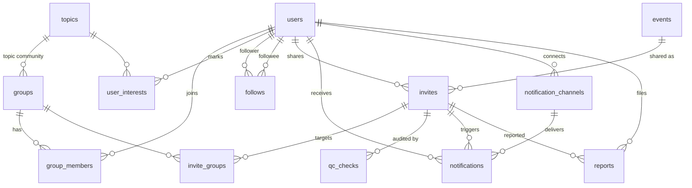

# 02 — Data Model

Source of truth: `src/db/schema.ts`. Apply with `npx drizzle-kit push` (prototype) or `drizzle-kit generate` + `migrate` (production, Phase 0).

## 1. ER diagram

## 2. Tables

### Identity & social
| Table | Purpose | Key columns / notes |
|---|---|---|
| `users` | Account + public profile | `email` (unique), `handle` (unique, lowercase), `display_name`, `headline`, `bio`, `role` (`user|moderator|admin`), `trust_score` 0–100 |
| `topics` | Interest taxonomy | `slug`, `name`, `emoji` — seeded: ML engineers, data scientists, climate, founders, VCs, developers, designers, PMs, researchers, health/biotech |
| `user_interests` | User ↔ topic | PK (`user_id`,`topic_id`). Saving interests **syncs membership** of the matching topic community |
| `follows` | Follow a person | PK (`follower_id`,`followee_id`), `notify` = the bell |

### Groups
| Table | Purpose | Key columns / notes |
|---|---|---|
| `groups` | Audiences | `type`: `general` (wide), `topic` (community, linked to `topic_id`), `custom` (user-made). `visibility`: `public|private`. `owner_id` for custom. |
| `group_members` | Membership | PK (`group_id`,`user_id`), `role` (`owner|member`), `muted` (read but don't notify) |

### Sharing & QC
| Table | Purpose | Key columns / notes |
|---|---|---|
| `events` | One row per unique event link | `canonical_url` UNIQUE (tracking params stripped), `url`, `host`, `title`, `description`, `image_url`, `site_name`, `starts_at`, `location` |
| `invites` | One person sharing one event | `event_id`, `shared_by_id`, `note`, `status` (`published|blocked|flagged`), `verdict` (`verified|caution|rejected`), `confidence`, `summary` |
| `invite_groups` | Invite → target audiences (M:N) | PK (`invite_id`,`group_id`) |
| `qc_checks` | **Immutable audit** of every QC run | `verdict`, `confidence`, `provider`, `model`, `findings` JSONB (`{code,severity,message,source}[]`), `ai_raw` JSONB, `page_fetched`, `duration_ms` |
| `qc_guidelines` | The rulebook | PK `key`, `scope` (`rule|ai`), `severity` (`block|warn|info`), `enabled`, `sort_order`. Rule codes in `rules.ts` must match a `key`; `scope = ai` rows are injected into the LLM prompt |
| `reports` | Community flags | UNIQUE (`invite_id`,`reporter_id`); 3 distinct reports → invite `flagged` |

### Notifications
| Table | Purpose | Key columns / notes |
|---|---|---|
| `notification_channels` | User's external destinations | `type` (`discord|whatsapp|signal`), `destination`, `verified`, `enabled`, `include_unverified`, `verify_code`, `verify_expires_at`. UNIQUE (`user_id`,`type`,`destination`) |
| `notifications` | One row per (user, invite, channel) | `channel` (`in_app|discord|…`), `status` (`pending|sent|dry_run|failed|skipped`), `attempts`, `error`, `read_at`, `sent_at`. Index (`user_id`,`created_at`) |

## 3. Visibility rule (single place: `lib/queries.ts → visibleTo`)

An invite is visible to a viewer if `status = 'published'` **and** at least one target group is `public` or the viewer is a member — or the viewer is the sharer (who can always see their own blocked/flagged invites to learn why). Anonymous viewers see only public-group invites. **All feed reads must go through this function.** In Phase 6, add Postgres Row-Level Security as defence in depth.

## 4. Indexing & performance notes

* Present: `invites(created_at)`, `invites(shared_by_id)`, `invites(event_id)`, `invite_groups(group_id)`, `group_members(user_id)`, `follows(followee_id)`, `notifications(user_id, created_at)`.
* Add in Phase 5: `invites(status, created_at DESC)` partial index where `status='published'`; GIN `to_tsvector` index on `events(title, description)`; `pg_trgm` on `users(handle, display_name)`.
* Use keyset pagination (`created_at, id`) instead of `OFFSET` for feeds.
* Partition `notifications` and `qc_checks` by month once > ~50 M rows.

## 5. Retention & privacy

| Data | Retention |
|---|---|
| `qc_checks.ai_raw` | 90 days then null out |
| `notifications` | 180 days |
| Channel `destination` | Encrypted (AES-GCM, key from KMS) — Phase 6; deleted on account deletion |
| Account deletion | Soft-delete 30 days → hard delete cascade (FKs are `ON DELETE CASCADE`) |

## 6. Planned tables (not yet built) — keep these names

| Table | Phase | Purpose |
|---|---|---|
| `sessions`, `accounts`, `verification_tokens` | P1 | Auth.js adapter tables |
| `jobs` (managed by pg-boss) | P3/P4 | Queue |
| `user_blocks` | P6 | Block/mute a user |
| `moderation_actions` | P6 | Who did what to which invite/user and why (audit) |
| `appeals` | P6 | Sharer contests a Blocked verdict |
| `domain_reputation` | P6 | Per-host verified/blocked counts → informs QC |
| `qc_cache` | P3 | `canonical_url`+`content_hash` → AI result, TTL 24 h |
| `notification_preferences` | P4 | Quiet hours, digest mode, daily caps, per-channel topic filters |
| `saved_events`, `event_reminders` | P5 | Bookmark + "remind me 24 h before" |
| `api_keys`, `webhooks_out` | P9 | Public API |
| `audit_log` | P6 | Security-relevant events |
